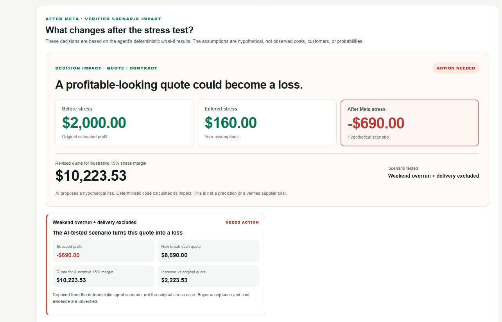
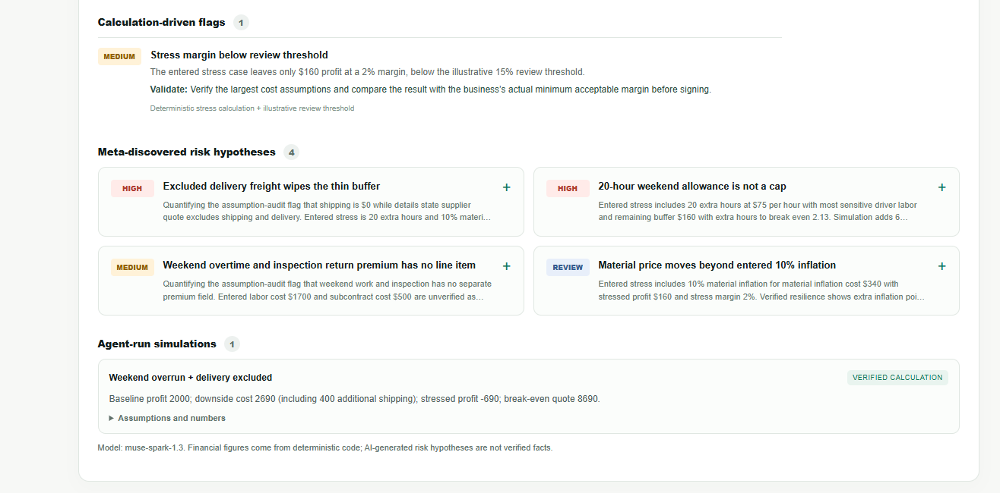
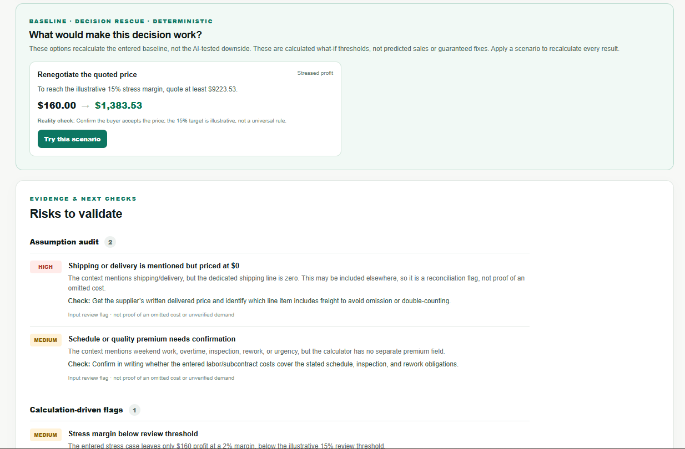

# FailFirst AI

**Break the plan. Not the business.**

FailFirst AI is a business decision stress-testing prototype built for the **Meta Global AI Developer Hackathon 2026**, Indie Developer track, *Build for Your World* theme.

A business decision can look profitable until an overlooked assumption changes. FailFirst AI combines **Meta Muse Spark 1.3 risk hypotheses** with **deterministic JavaScript simulations** so users can see what might break, how the modeled numbers change, and what to verify before committing money.



## What it does

Eight decision modes: **Quote / Contract**, **Subscription Launch**, **Hire vs Subcontract**, **Bulk vs Small Batch**, **Discount Test**, **Ad Spend ROI**, **New Service**, and **New Branch**.

- **Deterministic first:** profit, break-even, sensitivity, and scenario thresholds are computed in JavaScript, not invented by a language model.
- **Agentic stress tests:** Muse Spark proposes hypotheses and can call bounded scenario tools; the app recalculates the financial impact.
- **Auditable outcomes:** before/after comparisons, assumption audits, calculation-driven flags, and explicit evidence labels distinguish user inputs, calculations, and AI-generated scenarios.
- **Actionable review:** decision rescue options and validation checks help users understand what to investigate before committing.

The most severe modeled scenario is **not** necessarily the most likely. This tool is not a prediction engine or financial adviser.

## Demo example

An illustrative **$8,000 contract** starts with **$2,000 baseline profit**. Entered labor and material stress reduces that to **$160**. An AI-generated scenario for weekend work and excluded delivery can make the quote loss-making; deterministic code then recomputes the break-even and illustrative 15% target quote. **Meta-generated amounts vary between runs.**

## Architecture

```text
Browser (Next.js / React)
  ├─ 8 input modes + deterministic baseline calculations
  └─ POST /api/analyze
       ├─ Server validates and recalculates inputs
       ├─ Meta Model API: muse-spark-1.3
       ├─ Bounded tool calls → JavaScript scenario calculators
       └─ Structured hypotheses + deterministic result trace
```

**Stack:** Next.js 15, React 19, Node.js, JavaScript, Meta Model API, Muse Spark 1.3.

## Run locally

Node.js **20.6+** is required; Node 22 is recommended.

```bash
npm ci
npm test
npm run build
npm run dev
```

Open **http://localhost:3000**. The deterministic calculator works without a Meta API key.

To enable AI risk analysis, copy `.env.example` to `.env.local` and set your own server-side key:

```env
MODEL_API_KEY=your_meta_api_key_here
META_MODEL=muse-spark-1.3
```

Restart the development server. Never commit `.env.local`, expose the key in browser code, or put it in screenshots. `MODEL_API_KEY` is read only in the server API route.

## Tests and security

- **64 deterministic Node tests** covering all eight decision modes, scenario tooling, and financial safeguards (`npm test`).
- Run `npm run check:publish` before publishing to scan for accidentally included environment files and common credential patterns.
- **Do not deploy this prototype publicly with an unrestricted paid API key.** The `/api/analyze` endpoint has no authentication or rate limiting; add abuse protection and budget controls first.
- Production build and a live Meta request must be verified in the final environment; neither is proven by the unit tests.

## Screenshots

| Scenario impact | Risk hypotheses | Decision rescue |
| --- | --- | --- |
|  |  |  |

## Hackathon compliance

**Participant Guide:** public GitHub repository and a publicly accessible **3-minute demo** are required. Submission is through the Cerebral Valley participant platform by **Nov 4, 2026, 9:00 PM ET**. Show only work created during the hackathon; document original contributions and rights to code/assets. The scoring rubric weights **Impact 30%**, **Meta AI Tooling 25%**, **Technical Depth & Execution 20%**, and **Demo 25%**. See the [rules checklist](docs/HACKATHON_REQUIREMENTS_HY.md) for details and remaining portal-specific checks.

**Original work:** the initial FailFirst AI prototype was created during the hackathon on Oct 29, 2026, and expanded and tested through Oct 31. The project uses AI-assisted development; the financial calculations, bounded tool integration, eight-mode UI, and test suite are the submitted prototype.

## Hackathon materials

- [English submission description](docs/SUBMISSION_EN.md)
- [English 3-minute demo script](docs/DEMO_SCRIPT_EN.md)
- [3-minute screen-by-screen storyboard (Armenian)](docs/DEMO_STORYBOARD_HY.md)
- [GitHub publication steps (Armenian)](docs/GITHUB_PUBLISH_HY.md)
- [Official rules verification checklist (Armenian)](docs/HACKATHON_REQUIREMENTS_HY.md)
- [Detailed technical notes and modeling limits](docs/TECHNICAL_NOTES.md)

**Scope:** Hackathon MVP. Inputs are manual; no authentication, database, production multi-user features, real-world demand forecasts, or validated supplier costs. All AI-generated risks are hypothetical unless separately verified. No software reuse license has been granted in this repository.
